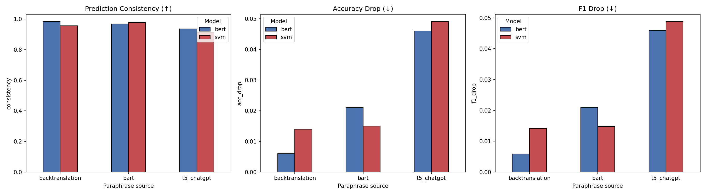

# NLP Model Robustness Evaluation Under Paraphrasing

**Topic classification · Transformer fine-tuning · Behavioral evaluation**

A team project investigating whether topic classifiers preserve their predictions when the same news text is rewritten. We compare **four classifiers across three paraphrasing methods**, using **1,000 balanced AG News test examples**.

**Stack:** Python · PyTorch · Hugging Face Transformers · scikit-learn · Sentence Transformers

## Results at a Glance

Results below are transcribed from **Table 3 of the team's final report, _Paraphrasing Robustness in Topic Classification Models_**; they are not newly reproduced runs.

- **BERT:** 94.3% original-sample accuracy and **96.3% average prediction consistency** across the three paraphrase sources.
- **T5 paraphrases:** accuracy drops of **4.6–6.5 percentage points**, compared with **0.6–2.1 points** for BART and back-translation.
- **Semantic drift matters:** 134 of 1,000 T5 paraphrases fall below 0.7 embedding cosine similarity, versus 5 for BART and 9 for back-translation. Prediction changes therefore cannot all be attributed to classifier failures.

The practical lesson is to evaluate both **classifier stability and paraphrase quality**. Accuracy on the original inputs alone does not describe behavior under wording changes.

## My Contribution — Leia Kim

I designed and implemented the project's three classification models:

- **TF-IDF + Logistic Regression:** word-level unigram/bigram features and L2-regularized classification.
- **TF-IDF + SVM:** LinearSVC with probability calibration.
- **BERT:** a four-class classifier based on `bert-base-uncased`, with AdamW, linear warmup scheduling, and gradient clipping.

I structured the models with consistent interfaces for **data loading, training, and prediction**, enabling integration with the team's robustness evaluation pipeline.

**Team scope:** TextCNN implementation, paraphrase generation, shared robustness evaluation, and report preparation were collaborative work by other team members. Repository contents and the results below describe the full team project, rather than work performed solely by me.

## Evaluation Design

1. Train topic classifiers on AG News.
2. Select **1,000 held-out test examples**, balanced at 250 per class, with sampling seed 42 as documented in the report.
3. Generate one rewrite per example using each of three paraphrase methods.
4. Compute sentence-embedding similarity and textual overlap to characterize the rewrites.
5. Compare original and paraphrased predictions using accuracy, Macro-F1, consistency, and class-level flip rates.

### Dataset

| Split / subset | Examples | Purpose |
| --- | ---: | --- |
| AG News training split | 120,000 | Source training split; actual training settings depend on the script |
| AG News test split | 7,600 | Source of held-out evaluation examples |
| Balanced robustness subset | 1,000 | 250 examples each: World, Sports, Business, Science/Tech |
| Generated rewrites | 3,000 | 1,000 per paraphrase method |

These results concern the balanced robustness subset, not accuracy over the full 7,600-example test split.

### Models

| Model | Implementation |
| --- | --- |
| TF-IDF + LR | Up to 100,000 unigram/bigram features; sublinear TF; Logistic Regression |
| TF-IDF + SVM | Same feature family; LinearSVC with probability calibration |
| TextCNN | Parallel convolutional filters of widths 3, 4, and 5; max pooling; dropout |
| BERT | Fine-tuned `bert-base-uncased`; maximum input length 128 tokens |

### Paraphrase Methods and Quality

| Method | Model / approach | Mean cosine similarity | Below 0.7 | Mean text overlap |
| --- | --- | ---: | ---: | ---: |
| T5 | `humarin/chatgpt_paraphraser_on_T5_base` | 0.803 | 134 / 1,000 | 0.41 |
| BART | `eugenesiow/bart-paraphrase` | 0.957 | 5 / 1,000 | 0.86 |
| Back-translation | MarianMT, English → French → English | 0.939 | 9 / 1,000 | 0.69 |

Quality statistics are from final-report Table 2. Similarity uses `all-MiniLM-L6-v2` sentence embeddings; overlap uses Python's `SequenceMatcher`.

**“T5-ChatGPT” in the report refers to the named T5 checkpoint, not calls to the ChatGPT API.** Embedding similarity is a proxy and does not establish semantic equivalence.

## Final Report Results

**Consistency** is the proportion of original/paraphrased pairs receiving the same prediction. **Flip rate = 1 − consistency**. Accuracy and Macro-F1 drops are original minus paraphrased performance.

| Model | Paraphrase source | Consistency | Original accuracy | Paraphrased accuracy | Accuracy drop (pp) | Macro-F1 drop (pp) |
| --- | --- | ---: | ---: | ---: | ---: | ---: |
| TF-IDF + SVM | Back-translation | 95.6% | 93.2% | 91.8% | 1.4 | 1.4 |
| TF-IDF + SVM | BART | 97.7% | 93.2% | 91.7% | 1.5 | 1.5 |
| TF-IDF + SVM | T5 | 91.4% | 93.2% | 88.3% | 4.9 | 4.9 |
| TF-IDF + LR | Back-translation | 96.2% | 92.1% | 90.9% | 1.2 | 1.2 |
| TF-IDF + LR | BART | 97.7% | 92.1% | 91.1% | 1.0 | 1.0 |
| TF-IDF + LR | T5 | 92.3% | 92.1% | 87.3% | 4.8 | 4.8 |
| TextCNN | Back-translation | 93.1% | 91.1% | 89.6% | 1.5 | 1.5 |
| TextCNN | BART | 95.0% | 91.1% | 89.9% | 1.2 | 1.2 |
| TextCNN | T5 | 85.7% | 91.1% | 84.6% | 6.5 | 6.5 |
| BERT | Back-translation | 98.3% | 94.3% | 93.7% | 0.6 | 0.6 |
| BERT | BART | 96.9% | 94.3% | 92.2% | 2.1 | 2.1 |
| BERT | T5 | 93.6% | 94.3% | 89.7% | 4.6 | 4.6 |

*pp = percentage points. Macro-F1 drops reproduce the report's rounded values.*

### Findings

- **BERT has the highest average consistency**, but is not the most consistent model on every source: LR and SVM reach 97.7% on BART versus BERT's 96.9%.
- **T5 introduces the largest degradation for every classifier.** It also produces more extensive rewrites and more low-similarity examples, so the results mix wording sensitivity with potential changes in meaning.
- **Sports is generally the most stable class.** The report identifies greater confusion among World, Business, and Science/Tech; TextCNN reaches a 20.4% Science/Tech flip rate under T5.
- A stable prediction is not necessarily correct. Consistency and accuracy should be read together.

## Selected Output



Additional committed plots are available in [outputs/bert](outputs/bert), [outputs/svm](outputs/svm), and [outputs/lr](outputs/lr). These images are existing project artifacts; the result table above is sourced from the final report.

## Code Map

| Location | Responsibility |
| --- | --- |
| [src/models/tfidf_baseline.py](src/models/tfidf_baseline.py) | LR training, prediction, and evaluation functions |
| [src/models/tfidf_svm_model.py](src/models/tfidf_svm_model.py) | Calibrated linear SVM |
| [src/models/bert_model.py](src/models/bert_model.py) | BERT fine-tuning and inference |
| [src/models/cnn_model.py](src/models/cnn_model.py) | TextCNN model and training utilities |
| [src/paraphrasing](src/paraphrasing) | T5, BART, and back-translation generation |
| [src/evaluation/evaluate.py](src/evaluation/evaluate.py) | SVM/BERT paired evaluation and plots |
| [src/evaluation/cnn_eval.py](src/evaluation/cnn_eval.py) | CNN paired evaluation |
| [data](data) | Committed original/paraphrase CSVs |
| [outputs](outputs) | Committed evaluation visualizations |

## Running the Available Evaluation Code

The repository contains research scripts rather than a single packaged command reproducing every final-report experiment.

Install dependencies from the repository root:

```bash
pip install -r requirements.txt
```

The following commands set the models import path and explicitly point evaluation functions at the committed data. They may download AG News and model weights and **train models when checkpoints are absent**, so they can require substantial time and memory.

SVM and BERT:

```bash
PYTHONPATH=src/models python -c "from src.evaluation.evaluate import main; main(csv_dir='data', out_dir='outputs/reproduced/svm_bert')"
```

TextCNN:

```bash
PYTHONPATH=src/models python -c "from src.evaluation.cnn_eval import main; main(csv_dir='data', out_dir='outputs/reproduced/cnn')"
```

These commands describe the current code paths; they have not been validated as exact reproductions of Table 3. LR model functions are provided, but the shared `evaluate.py` entry point currently runs SVM and BERT only.

Paraphrase-generation scripts use working-directory-relative input paths, including `sample_1000.csv`; prepare the expected input before rerunning them. The committed paraphrase CSVs can be used without regenerating rewrites. Additional tokenizer dependencies, such as `sentencepiece` and `sacremoses`, may be needed depending on the generation model.

## Limitations and Reproducibility Notes

- **Semantic drift:** Table 3 is presented as the unfiltered evaluation, following the final report's conclusion. Earlier report sections describe a filtered evaluation, but no separate filtered-results table is supplied. No filtered scores are claimed here.
- **CNN embeddings:** the methods section describes GloVe integration, while the results section says GloVe was unavailable and the reported CNN used randomly initialized embeddings. Exact reproduction requires confirming the original run configuration.
- **BERT training:** the report describes three epochs, while the shared evaluation runner configures a 40,000-example training subset and two epochs when training from scratch. A fresh run should not be assumed to match the report.
- **Missing run artifacts:** trained checkpoints and the per-run JSON summaries referenced in the report are not committed in the current repository snapshot.
- The study uses one dataset, four broad topic classes, and one balanced evaluation subset. Statistical uncertainty and human validation of paraphrase meaning are not established by the reported table.
- Model comparisons are descriptive; the experiments do not isolate architecture from all training and representation differences.

## Team and Next Steps

**Team:** Atharva Naik, Gaurav Khatwani, Minkyung Kim, Leia Kim, and Pallavi Pandey.

The final report is complete; reproducibility cleanup remains. Next steps are to reconcile the recorded training settings, add machine-readable results and a complete LR evaluation entry point, validate paraphrases with human annotation, and test robustness on additional datasets.

## References

- [AG News dataset](https://huggingface.co/datasets/fancyzhx/ag_news)
- [BERT](https://arxiv.org/abs/1810.04805)
- [CheckList: Beyond Accuracy](https://aclanthology.org/2020.acl-main.442/)
- [T5 paraphraser checkpoint](https://huggingface.co/humarin/chatgpt_paraphraser_on_T5_base)
- [Sentence Transformers](https://www.sbert.net/)
